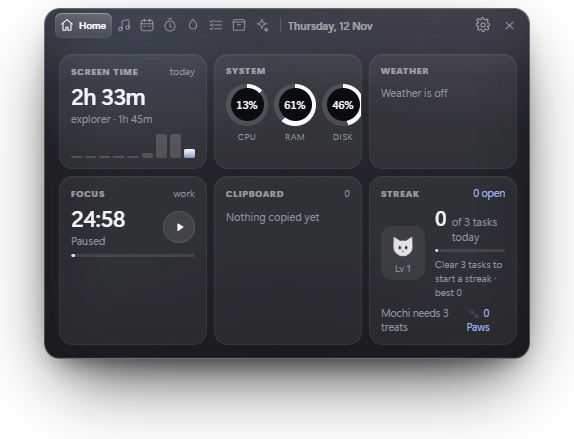
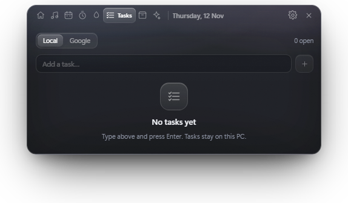
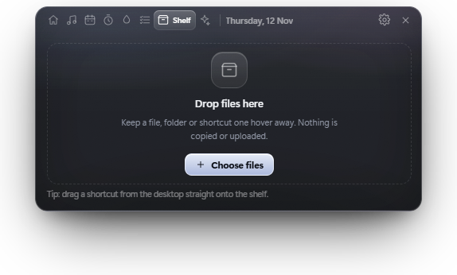
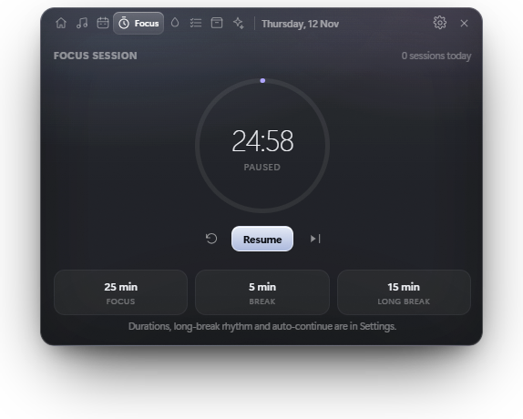
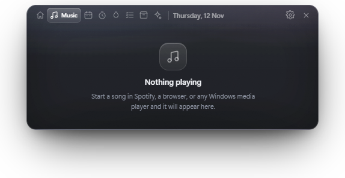
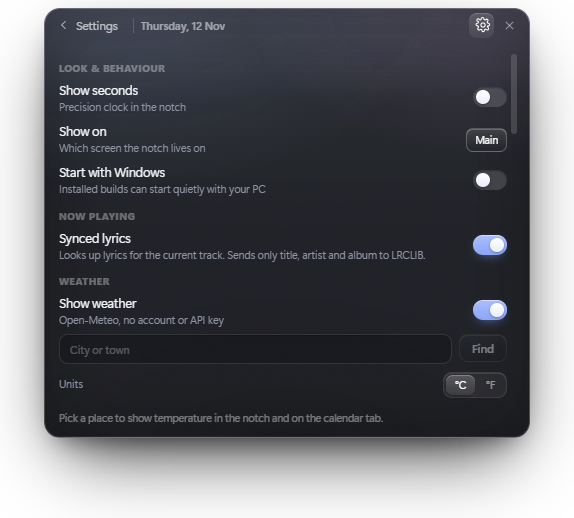

# Notcha

A Dynamic Island for Windows 10 and 11: a small glass pill that sits below the top edge of the screen and expands into a panel when you hover it.

Everything runs locally. There is no account, no telemetry and no cloud sync — settings and history live in `%APPDATA%/Notcha`.

## Screenshots



| Tasks | Shelf |
| :-: | :-: |
|  |  |

| Focus | Now playing |
| :-: | :-: |
|  |  |



## What it does

- **Now playing** — the current track, play/pause and skip, driven by the Windows media session.
- **Calendar** — a week of Google Calendar events, refreshed in the background (every five minutes, and when you return to the notch) whether or not the tab is open.
- **Tasks** — a task list where each newly completed task feeds Mochi the cat a treat. Every three treats is a level, which pays out Paws to spend on themes.
- **Focus** — a work/break timer that shows in the pill.
- **Water** — a simple intake counter.
- **Shelf** — keep files and folders one hover away, plus a local file converter (images, audio and video) with quality and size controls, single file or batch.
- **Clipboard** — recent text clips, click to copy again.
- **Weather, system stats, screen time** — a glance at the machine you are using.
- **Themes** — five colour themes unlocked with Paws.

## Requirements

- Windows 10 or 11
- Node.js 22+ and npm (development only)

## Development

```bash
npm install
npm run dev        # electron-vite dev server
npm run typecheck  # tsc for main, preload and renderer
npm run build      # compile main, preload and renderer into out/
npm start          # run the compiled app
```

The tray and window icons are generated, not checked in by hand:

```bash
npm run icons      # writes resources/tray.png, build/icon.png, build/icon.ico
```

## Packaging

```bash
npm run package    # electron-vite build && electron-builder --win
```

The NSIS installer is written to `release/`. The build is unsigned, so Windows SmartScreen will warn on first launch of the produced installer.

### Bundled ffmpeg

The file converter shells out to a bundled ffmpeg binary via [`ffmpeg-static`](https://www.npmjs.com/package/ffmpeg-static). It is unpacked from the asar archive (`asarUnpack` in `package.json`) so it can be executed. That binary is an **LGPL/GPL** build — it includes `libx264` — so shipping installers means distributing ffmpeg under its own licence; keep its licence text and source link with any binary release, or swap in an LGPL-only build if that matters for your distribution.

## Google Calendar and Tasks

Calendar and Tasks are optional and off until you connect them:

1. In Google Cloud Console, create a project and enable the **Google Calendar API** and **Google Tasks API**.
2. Configure the OAuth consent screen (External, Testing is fine) and add your account as a test user.
3. Create an OAuth client of type **Desktop app** and copy its client ID.
4. Paste that ID into Settings → **Google Calendar & Tasks** → **Connect**.

The app uses PKCE with a loopback redirect on a random `127.0.0.1` port, so it never needs a client secret. Tokens are stored with Electron `safeStorage` in `%APPDATA%/Notcha/google-tokens.bin`. While the consent screen stays in Testing, Google expires the refresh token after seven days.

## Layout

```
src/main          Electron main process: island window, tray, services
src/preload       Context bridge (window.island)
src/renderer      React UI: the panel, tabs, styles
src/shared        Types and pure logic shared by both sides
tools             Icon generation and helper scripts
resources         Runtime assets copied into the packaged app
```

## Licence

MIT — see [LICENSE](LICENSE).

The bundled ffmpeg binary is the exception: it ships under its own licence (see the ffmpeg note above), so include that licence text and a source link with any binary release.
